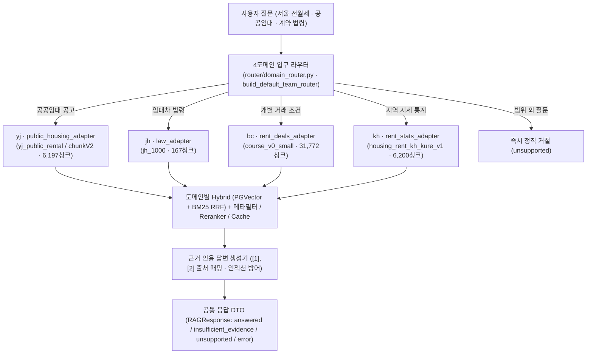
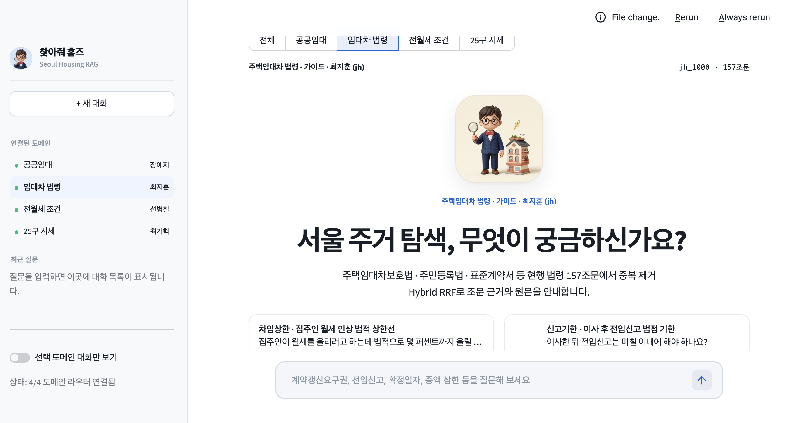

<div align="center">

# 🏠 서울 주거 탐색 RAG (`rag-home-api`)

**서울 상경 20~30대 청년을 위한 전월세 시세 · 공공임대 공고 · 주택임대차 법령 근거 기반 4도메인 통합 RAG 서비스**


*흩어져 있고 읽기 어려운 공고문·법령·실거래 데이터를 출처와 함께 정확하게 답하고, 근거가 없으면 솔직하게 거절합니다.*

</div>

---

## 📌 프로젝트 배경 및 원칙

서울에 처음 독립하는 20~30대 청년은 *"내 예산과 자격으로 들어갈 수 있는 전월세 집과 공공임대"*를 찾기 위해 LH·SH 수십 쪽짜리 PDF 공고문, 국토부 실거래가, 주택임대차 법령을 따로 뒤져야 합니다.

- **핵심 우선순위**: **`품질 > 시간 > 비용`** (주거·금전 의사결정과 직결되므로 환각을 최소화)
- **안전 응답 원칙**:
  1. 모든 답변에 **출처(공고명·쪽 번호·조문·문서 기준일)**를 명시합니다.
  2. 수집 데이터에 근거가 없으면 추측하지 않고 **근거 부족 거절(`insufficient_evidence`, 빈 인용)**을 반환합니다.
  3. 검색·LLM 예외는 거절과 섞이지 않도록 **`error`** 상태로 분리하며 캐시에 저장하지 않습니다.
- **제외 범위**: 매매·분양 청약, 서울 외 지역, 실시간 매물 중개, 개별 법률 자문·전세사기 확정 판단, 대출 상품 추천

---

## 🏗️ 시스템 아키텍처

4명의 도메인별 최적 청킹·검색 전략을 원형 그대로 보존(Zero-Edit)하면서 **멀티 컬렉션(단일 DB 50,752행 무충돌) + 4도메인 입구 라우터 + 공통 응답 규약(`RAGResponse`)**으로 통합했습니다.



---

## 👥 팀원별 담당 도메인 및 최종 성과

> 공통 환경: 생성/평가 `gpt-6-luna` · DB `PostgreSQL + pgvector` · 표준 임베딩 `text-embedding-3-small` (1,536차원, `kh` 시세 통계는 한국어 특화 `KURE-v1` 별도 컬렉션 격리 운용)

| 담당자 | 도메인 | 컬렉션 | 최종 채택 전략 | 봉인 `TEST` (20문항) 확정 결과 | 상태 | 상세 문서 |
| :---: | :--- | :--- | :--- | :--- | :---: | :---: |
| **예지 (`yj`)** | 공공임대 공고문<br/>*(LH·SH 90건, 2,482p)* | `yj_public_rental`<br/>*(필터: `chunkV2`)* | 표 헤더 복제·병합 셀 채우기(`V2`)<br/>+ Hybrid RRF + LLM 리랭킹(`C`)<br/>+ 주어 명시 프롬프트 · 리라이트 기각 | **Hit@5 `13/17 (76.5%)`**<br/>거절 `3/3` · 인용 `100%` · 오류 `0`<br/>**CP `0.86` · CR `0.88` · F `0.97` · AR `0.89`** | ✅ 완료 | [report.md](src/rag_home_api/test/yj/docs/report.md) |
| **지훈 (`jh`)** | 주택임대차 법령·가이드<br/>*(원문 157조문, 167청크)* | `jh_1000` | 1000/200 청킹 + 중복 제거(`0.95`)<br/>+ Kiwi BM25/Vector RRF (`B`)<br/>*(C/리라이트 과잉 지연 정량 기각)* | **Hit@5 `17/17 (100%)`** · 필수근거 `17/17`<br/>안전 보류 `3/3` · 오류 `0/20`<br/>평균 지연 **`1.70초`** | ✅ 완료 | [README_법령PR.md](src/rag_home_api/test/jh/README_법령PR.md) |
| **병철 (`bc`)** | 관악구 전월세 실거래<br/>*(개별 거래 조건 탐색)* | `course_v0_small`<br/>*(31,772청크)* | 1거래 = 1청크(`V0`) + 자연어 JSON<br/>조건 추출·정규화 v2 + Vector/BM25<br/>공통 필터 + `ko-reranker` + 캐시 | **기존 TEST**: `17/17 (100%)` (`C` CP/CR `1.00`)<br/>**신규 TEST (`T21~T40`)**: `15/17 (88.2%)`<br/>거절 `3/3` · 비추측 확인 요청 유지 | ✅ 완료 | [development_history.md](src/rag_home_api/test/bc/docs/development_history.md) |
| **기혁 (`kh`)** | 서울 25구 전월세 시세<br/>& **팀 4인 통합·워크벤치** | `housing_rent_kh_kure_v1`<br/>*(+ `housing_rent_kh`)* | 56.2만 건 → 6,200 시세 요약 블록<br/>+ `KURE-v1` + `FIX B(25:75, k=15)`<br/>+ 사전 필터 v2 + 리랭킹 + 버전 캐시 | **`C+Rewrite`**: `R@12 1.00` · **`Hit@5 17/17`**<br/>**CP `1.00` · CR `1.00` · F `0.93` · AR `0.84`** (`0.944`)<br/>**`Cache Warm`**: **`0.3ms`** · 거절 `3/3` | ✅ 완료 | [STEP7 보고서](src/rag_home_api/test/kh/reports/STEP7_실패분석_및_vNext_개선설계.md)<br/>[실험기록.md](src/rag_home_api/test/kh/실험기록.md) |

---

## 🤝 4인 통합 실증 검증 결과

| 검증 항목 | 최종 실측 결과 | 세부 내용 |
| :--- | :---: | :--- |
| **단일 DB 멀티 컬렉션 공존** | **`50,752`행 · PK 충돌 `0건`** | 6개 컬렉션(`jh_1000` 167 · `yj_public_rental` 6,197 · `housing_rent_kh*` 12,400 · `course_v0_small` 31,772 · `seoul_housing_unified` 216) 무손상 공존 |
| **4도메인 라이브 통합 스모크** | **`18/18 (100%) PASS`** | 도메인 라우팅 `18/18` · 응답 상태(`answered 12 / insufficient 4 / unsupported 2`) `18/18` · 핵심 정답 키워드 `12/12` · 오류 `0건` |
| **통합 평가셋 무결성 검증** | **`120/120 (100%) PASS`** | `yj(30) + jh(30) + bc(30) + kh(30) = 120문항` (`dev 40 + test 80`, 중복 ID `0건` · 스키마 오류 `0건`, + `bc` 신규 `T21~T40` 20문항) |
| **4인 통합 분석 워크벤치** | **83스텝 · 4인 전원 지원** | Streamlit 대시보드에서 4인 결과·회차별 리포트·문항별 X-Ray 비교 및 HTML/CSV/Markdown 내보내기 지원 |

---

## 📊 수집 데이터셋 (`src/rag_home_api/shared/docs/`)

| 데이터 파일 | 규모 | 수집 기준 | 주요 활용 |
| :--- | :--- | :--- | :--- |
| `공공임대_공고문.jsonl` | LH·SH 공고 90~100건 (2,482~2,543쪽) | 2025-11 ~ 2026-11 | 공공임대 입주자격·임대조건·일정 |
| `청년안심주택_공고문.jsonl` | 공고 313건 (2,056쪽) | 2025-11 ~ 2026-11 | 청년안심주택 자격·일정·임대료 |
| `일반전월세_법령가이드.jsonl` | 법령·가이드 7건 (157조문, 426~430줄) | 현행 법령 기준 | 계약갱신요구권·대항력·확정일자 등 |
| `서울_전월세_최근1년_<자치구>.csv` | 25개 자치구 **562,624건** | 2025-11 ~ 2026-11 | 자치구·동·면적별 실거래 조건 및 시세 |
| `public_housing_units.csv` 외 1종 | 1,269호실 / 가격 조건 5,076건 | 청년 매입임대 공고 2건 | 호실별 면적·순위별 보증금/월세 |
| `서울주택도시개발공사_주택관리현황.csv` | SH 관리 825개 단지 | 2023-05-03 기준 | 공공임대 단지 위치·유형 참고 |

---

## 📁 프로젝트 구조

```text
AX_RAG/
├── README.md                                  # 프로젝트 전체 소개 (본 문서)
├── pyproject.toml                             # Python 3.13 + uv 의존성 관리
├── .env.example                               # 환경변수 템플릿 (.env는 Git 제외)
├── .streamlit/config.toml                     # Streamlit 라이트 테마 고정 설정
├── docs/
│   └── team_integration_spec.md               # 4인 통합 규약 (컬렉션 · PK · RAGResponse DTO)
└── src/rag_home_api/
    ├── config.py                              # 공용 모델·DB 설정
    ├── collect/                               # 공고문·법령·실거래 데이터 수집 및 정제 스크립트
    ├── ingest/                                # 공용 로더·검증기·PGVector 인덱서
    ├── retrieval/                             # 공용 Vector · BM25 · Hybrid RRF · Reranker
    ├── optimize/                              # 캐싱 · 쿼리 리라이트 · HyDE
    ├── router/                                # 4도메인 입구 라우터 & 무수정(Zero-Edit) 어댑터
    │   ├── __init__.py                        # build_default_team_router() 통합 조립
    │   ├── domain_router.py                   # 4도메인 분류 + 오류 격리(TeamDomainRouter)
    │   ├── public_housing_adapter.py          # [예지] 공공임대 어댑터
    │   ├── law_adapter.py                     # [지훈] 법령 어댑터
    │   ├── rent_deals_adapter.py              # [병철] 개별 거래 조건 어댑터
    │   └── rent_stats_adapter.py              # [기혁] 25구 시세 통계 어댑터
    ├── ui/                                    # 찾아줘 홈즈 4도메인 통합 Streamlit 챗봇 UI
    │   ├── holmes_chat.py                     # 4도메인 탭 · 테마별 추천 질문 · 출처/근거 화면
    │   └── assets/                            # 3D 홈즈 마스코트 · 아바타 이미지
    ├── shared/
    │   ├── core/                              # 공용 로거 · PGVector 연결 팩토리(make_db_id)
    │   ├── schemas/                           # 공통 응답 계약 (rag_contract.py)
    │   └── docs/                              # 팀 공용 원본 데이터 · 문서목록 · 문제 정의(problem.md)
    └── test/                                  # 팀원별 독립 실험·평가·리포트 산출물
        ├── yj/                                # [예지] 공공임대 공고문 (V2 표 청킹 · A/B/C/D · RAGAS · report.md)
        ├── jh/                                # [지훈] 주택임대차 법령 (jh_1000 · A/B/C · 리라이트)
        ├── bc/                                # [병철] 전월세 거래 조건 탐색 (필터 v2 · 캐시 · A/B/C)
        └── kh/                                # [기혁] 25구 시세 요약 · STEP 7/신뢰성 부록 · 4인 통합 대시보드
```

---

## 🚀 빠른 시작 (Quick Start)

### 1. 환경 설치 및 `.env` 설정
```bash
# 저장소 이동 및 의존성 설치 (Python 3.13+, uv 필요)
cd AX_RAG
uv sync --locked

# 환경변수 파일 생성 후 OPENAI_API_KEY, DATABASE_URL 입력
cp .env.example .env
```

> PostgreSQL에 `pgvector` 확장이 활성화되어 있어야 합니다 (`CREATE EXTENSION IF NOT EXISTS vector;`).

### 2. 찾아줘 홈즈 챗봇 실행 (실행 인터페이스 · Streamlit)
질문을 입력하면 4도메인 라우터가 담당 도메인으로 보내고, 답변·출처·상태(답변 / 근거 부족 / 지원 범위 밖 / 오류)를 한 화면에 보여 줍니다.

<div align="center">
  
</div>

```bash
uv run streamlit run src/rag_home_api/ui/holmes_chat.py
# Intel Mac 등에서 onnxruntime 설치 오류가 나면: uv run --no-sync streamlit run src/rag_home_api/ui/holmes_chat.py
```
> 실제 답변에는 `.env`의 `OPENAI_API_KEY`와 4개 컬렉션이 적재된 PostgreSQL(`DATABASE_URL`)이 필요합니다. DB에 연결되지 않으면 앱은 멈추지 않고 `error` 상태로 표시합니다.

### 3. 4도메인 통합 라우터 실행 (Python)
```python
from rag_home_api.router import build_default_team_router

router = build_default_team_router()
resp = router.invoke("집주인이 월세를 올리려고 하는데 법적으로 몇 퍼센트까지 올릴 수 있나요?")
print(resp.status, resp.domain, resp.answer)
```

### 4. 4인 통합 분석 워크벤치 실행 (Streamlit)
```bash
uv run --with streamlit streamlit run src/rag_home_api/test/kh/eval_dashboard.py
```

### 5. 파트별 개별 실행 예시

<details>
<summary><b>🏠 공공임대 공고문 (yj) — 청킹 · 적재 · 평가 실행</b></summary>

```bash
# 1) 표 보존 청킹 V2 생성 & JSONL 검증
uv run python src/rag_home_api/test/yj/works/02_chunk_docs/V2.py
uv run python src/rag_home_api/test/yj/works/validate_jsonl.py

# 2) PGVector 단일 컬렉션(yj_public_rental) 증분 적재
uv run python src/rag_home_api/test/yj/works/03_build_index/indexer.py

# 3) A / B / C / C_plus_opt 비교 평가 실행 (dev / test)
uv run python src/rag_home_api/test/yj/works/04_eval/run_eval.py
```
</details>

<details>
<summary><b>⚖️ 주택임대차 법령 (jh) — 무비용 검증 및 색인 점검</b></summary>

```bash
python -X utf8 src/rag_home_api/test/jh/rag/validate_eval.py
python -X utf8 src/rag_home_api/test/jh/rag/run.py --check-index --collection jh_1000
python -X utf8 src/rag_home_api/test/jh/rag/run.py --split all --modes A B C --preset route --rewrite --generate
```
</details>

<details>
<summary><b>🏘️ 전월세 개별 거래 (bc) — 검증 및 색인 실행</b></summary>

```bash
uv run python src/rag_home_api/test/bc/run_course_index.py --stage check
uv run python src/rag_home_api/test/bc/run_course_index.py --stage index
```
</details>

<details>
<summary><b>📊 서울 25구 전월세 시세 (kh) — 회차별 리포트 재생성</b></summary>

```bash
uv run python -m rag_home_api.test.kh.build_eval_reports
uv run python -m rag_home_api.test.kh.unify_team_results --from-git
```
</details>

---

## 🛠️ 핵심 기술 결정 및 트러블슈팅 하이라이트

- **PGVector 전역 PK 충돌 원천 차단 (`make_db_id`)**: `langchain_pg_embedding.id`는 모든 컬렉션이 공유하는 단일 기본키이므로 `{collection}:{chunk_id}` 접두어를 표준화해 단일 DB에서 6개 컬렉션 **50,752행 무충돌 공존**을 달성했습니다.
- **마크다운 표 구조 보존 청킹 (`yj` · `chunkV2`)**: 공공임대 공고문의 66.3%가 마크다운 표(743쪽 2단 병합 헤더)임을 진단하고, 행 단위 분할 + 2단 헤더 자동 복제 + 앞쪽 세로 병합 셀 채우기로 **표 헤더 유실 `1,192 → 0건`**을 달성했습니다.
- **원천 정제 & 자연어 조건 필터링 (`jh` · `bc`)**: 410건 PDF의 깨진 줄·NUL·워터마크를 정제해 팀 데이터 기반을 세웠고(`jh`), 숫자 조건 검색 병목을 자연어 JSON 조건 추출 + Vector/BM25 공통 필터 v2로 해결해 `Hit@5 6/17 → 17/17`을 달성했습니다(`bc`).
- **RRF 역설 해부 · 버전 캐시 `0.3ms` · 30회 신뢰성 포렌식 (`kh`)**: `KURE-v1` + `FIX B(25:75, k=15)` + 사전 필터 v2 + 리랭커 스마트 스킵 및 버전 인식 캐시(`0.3ms`)를 구현했고, 30회 반복 측정(720측정 · 1,198 Claim)으로 `strictness=3` 분산 5배 축소와 `AR↔F` 어휘 트레이드오프를 원문 로그로 규명했습니다.
- **4인 통합 라우팅 정밀화 & 데이터 기반 기각 원칙**: `"무주택세대구성원"` 속 `"대구"`, `"어떤 방법으로"` 속 `"법으로"` 오탐을 한글 단어 경계 가드(`(?<![가-힣])`)로 수정해 **18/18 (100%) 통합 스모크 통과**를 달성했으며, 4명 모두 무효 최적화(지훈 C/리라이트 · 예지 리라이트 · 병철 `large`/시제 변환 · 기혁 상시 리라이트)를 실측 데이터로 기각했습니다.

---

## 📚 주요 문서 링크

- [문제 정의 및 데이터 범위 (`problem.md`)](src/rag_home_api/shared/docs/problem.md)
- [4인 통합 아키텍처 규약서 (`team_integration_spec.md`)](docs/team_integration_spec.md)
- [공공임대 공고문 최종 평가·실패 분석 보고서 (`yj/docs/report.md`)](src/rag_home_api/test/yj/docs/report.md)
- [주택임대차 법령 인계 및 실험 기록 (`jh/README_법령PR.md`)](src/rag_home_api/test/jh/README_법령PR.md)
- [전월세 거래 탐색 개발 이력 (`bc/docs/development_history.md`)](src/rag_home_api/test/bc/docs/development_history.md)
- [서울 25구 시세 STEP 7 실패 분석 & 4인 통합 실증 (`kh/reports/STEP7_실패분석_및_vNext_개선설계.md`)](src/rag_home_api/test/kh/reports/STEP7_실패분석_및_vNext_개선설계.md)
- [서울 25구 시세 전체 실험 기록 (`kh/실험기록.md`)](src/rag_home_api/test/kh/실험기록.md) · [18회차 리포트 인덱스 (`kh/reports/README.md`)](src/rag_home_api/test/kh/reports/README.md)
