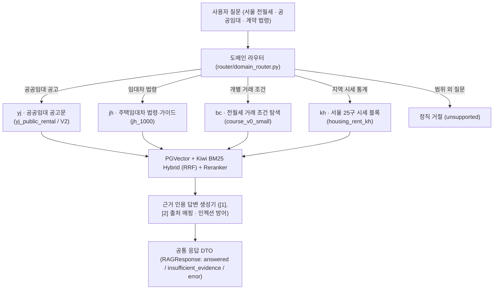

<div align="center">

# 🏠 서울 주거 탐색 RAG (`rag-home-api`)

**서울 상경 20~30대 청년을 위한 전월세 시세 · 공공임대 공고 · 주택임대차 법령 근거 기반 RAG 서비스**


*흩어져 있고 읽기 어려운 공고문·법령·실거래 데이터를 출처와 함께 정확하게 답하고, 근거가 없으면 솔직하게 거절합니다.*

</div>

---

## 📌 프로젝트 배경 및 원칙

서울에 처음 독립하는 20~30대 청년은 *"내 예산과 자격으로 들어갈 수 있는 전월세 집과 공공임대"*를 찾기 위해 LH·SH 수십 쪽짜리 PDF 공고문, 국토부 실거래가, 주택임대차 법령을 따로 뒤져야 합니다.

- **핵심 우선순위**: **`품질 > 시간 > 비용`** (주거·금전 의사결정과 직결되므로 환각을 최소화)
- **안전 응답 원칙**:
  1. 모든 답변에 **출처(공고명·쪽 번호·문서 기준일)**를 명시합니다.
  2. 수집 데이터에 근거가 없으면 추측하지 않고 **근거 부족 거절(`insufficient_evidence`)**을 반환합니다.
  3. 검색·LLM 예외는 거절과 섞이지 않도록 **`error`** 상태로 분리하며 캐시에 저장하지 않습니다.
- **제외 범위**: 매매·분양 청약, 서울 외 지역, 실시간 매물 중개, 개별 법률 자문·전세사기 확정 판단, 대출 상품 추천

---

## 🏗️ 시스템 아키텍처

4명의 도메인별 최적 청킹·검색 전략을 보존하면서 **멀티 컬렉션 + 입구 라우터 + 공통 응답 규약(`RAGResponse`)**으로 통합하는 구조입니다.



---

## 👥 팀원별 담당 도메인 및 진행 현황

> 공통 모델: 임베딩 `text-embedding-3-small` (1,536차원) · 생성/평가 `gpt-6-luna` · DB `PostgreSQL + pgvector`

| 담당자 | 도메인 | 컬렉션 | 핵심 전략 | 주요 평가 결과 | 상태 | 상세 문서 |
| :---: | :--- | :--- | :--- | :--- | :---: | :---: |
| **예지 (`yj`)** | 공공임대 공고문<br/>*(LH·SH 90건, 2,482p)* | `yj_public_rental`<br/>*(필터: `V2`)* | 표 헤더·병합 셀 보존 청킹(`V2`)<br/>+ Hybrid RRF + LLM 리랭킹<br/>+ 주어 명시 프롬프트 · 리라이트 검증 | **TEST (20문항, C)**: Hit@5 `13/17 (76.5%)`<br/>거절 `3/3` · 인용 `100%` · 오류 `0`<br/>**CP `0.86` · CR `0.88` · F `0.97` · AR `0.89`** | ✅ 완료 | [report.md](src/rag_home_api/test/yj/docs/report.md) |
| **지훈 (`jh`)** | 주택임대차 법령·가이드<br/>*(7건, 167청크)* | `jh_1000` | 1000/200 청킹 + 중복 제거(`dedupe`)<br/>+ Kiwi BM25/Vector RRF + `ko-reranker`<br/>+ 숫자·조문 보호 리라이트 검증 | **TEST (20문항, B/C)**: Hit@5 `17/17 (100%)`<br/>안전 보류 `3/3` · 오류 `0/20` | ✅ 완료 | [README_법령PR.md](src/rag_home_api/test/jh/README_법령PR.md) |
| **병철 (`bc`)** | 서울 전월세 실거래<br/>*(개별 거래 조건 탐색)* | `course_v0_small` | 1거래 = 1청크(`V0`)<br/>+ 자연어 조건 추출·정규화 필터<br/>+ `ko-reranker` + 정확 일치 응답 캐시 | **기존 TEST**: `17/17` (`C` CP/CR `1.00`)<br/>**신규 TEST (T21~T40)**: Hit@5 `15/17 (88.2%)` | ✅ 완료 | [README.md](src/rag_home_api/test/bc/README.md) |
| **기혁 (`kh`)** | 서울 25구 전월세 시세<br/>& **팀 통합·대시보드** | `housing_rent_kh` | 562,624건 → 6,200 시세 요약 블록<br/>+ 자치구·동·평형 메타 필터<br/>+ 통합 라우터·4인 결과 통합 대시보드 | **DEV (10문항, B+필터)**: Hit@5 `8/8`<br/>거절 `2/2` · **CP `0.82` · CR `0.81` · F `0.98`** | 🔄 진행 중<br/>*(test·통합)* | [실험기록.md](src/rag_home_api/test/kh/실험기록.md) |

---

## 📊 수집 데이터셋 (`src/rag_home_api/shared/docs/`)

| 데이터 파일 | 규모 | 수집 기준 | 주요 활용 |
| :--- | :--- | :--- | :--- |
| `공공임대_공고문.jsonl` | LH·SH 공고 90~100건 (2,482~2,543쪽) | 2025-11 ~ 2026-11 | 공공임대 입주자격·임대조건·일정 |
| `청년안심주택_공고문.jsonl` | 공고 313건 (2,056쪽) | 2025-11 ~ 2026-11 | 청년안심주택 자격·일정·임대료 |
| `일반전월세_법령가이드.jsonl` | 법령·가이드 7건 (426~430줄) | 현행 법령 기준 | 계약갱신요구권·대항력·확정일자 등 |
| `서울_전월세_최근1년_<자치구>.csv` | 25개 자치구 **562,624건** | 2025-11 ~ 2026-11 | 자치구·동·면적별 실거래 조건 및 시세 |
| `public_housing_units.csv` 외 1종 | 1,269호실 / 가격 조건 5,076건 | 청년 매입임대 공고 2건 | 호실별 면적·순위별 보증금/월세 |
| `서울주택도시개발공사_주택관리현황.csv` | SH 관리 825개 단지 | 2023-05-03 기준 | 공공임대 단지 위치·유형 참고 |

---

## 📁 프로젝트 구조

```text
rag-home-api/
├── README.md                                  # 프로젝트 전체 소개 (본 문서)
├── pyproject.toml                             # Python 3.13 + uv 의존성 관리
├── .env.example                               # 환경변수 템플릿 (.env는 Git 제외)
├── docs/
│   └── team_integration_spec.md               # 4인 통합 규약 (컬렉션 · PK · RAGResponse DTO)
└── src/rag_home_api/
    ├── config.py                              # 공용 모델·DB 설정
    ├── collect/                               # 공고문·법령·실거래 데이터 수집 및 정제 스크립트
    ├── ingest/                                # 공용 로더·검증기·PGVector 인덱서
    ├── retrieval/                             # 공용 Vector · BM25 · Hybrid RRF · Reranker
    ├── optimize/                              # 캐싱 · 쿼리 리라이트 · HyDE
    ├── router/                                # 도메인 입구 라우터 & 어댑터
    ├── shared/
    │   ├── core/                              # 공용 로거 · PGVector 연결 팩토리
    │   ├── schemas/                           # 공통 응답 계약 (rag_contract.py)
    │   └── docs/                              # 팀 공용 원본 데이터 및 문제 정의 (problem.md)
    └── test/                                  # 팀원별 독립 실험·평가·산출물
        ├── yj/                                # [예지] 공공임대 공고문 (V2 표 청킹 · A/B/C/D · RAGAS · report.md)
        ├── jh/                                # [지훈] 주택임대차 법령 (jh_1000 · A/B/C · 리라이트)
        ├── bc/                                # [병철] 전월세 거래 조건 탐색 (필터 · 캐시 · A/B/C)
        └── kh/                                # [기혁] 전월세 25구 시세 요약 · 4인 통합 대시보드
```

---

## 🚀 빠른 시작 (Quick Start)

### 1. 환경 설치 및 `.env` 설정
```powershell
# 저장소 이동 및 의존성 설치 (Python 3.13+, uv 필요)
cd rag-home-api
uv sync --locked

# 환경변수 파일 생성 후 OPENAI_API_KEY, DATABASE_URL 입력
Copy-Item .env.example .env
```

> PostgreSQL에 `pgvector` 확장이 활성화되어 있어야 합니다 (`CREATE EXTENSION IF NOT EXISTS vector;`).

### 2. 파트별 실행 예시

<details>
<summary><b>🏠 공공임대 공고문 (yj) — 적재 및 평가 실행</b></summary>

```powershell
# 1) 표 보존 청킹 V2 생성 & JSONL 검증
uv run python src/rag_home_api/test/yj/works/02_chunk_docs/V2.py
uv run python src/rag_home_api/test/yj/works/validate_jsonl.py

# 2) PGVector 단일 컬렉션(yj_public_rental) 증분 적재
uv run python src/rag_home_api/test/yj/works/03_build_index/indexer.py

# 3) A / B / C / C_plus_opt 비교 평가 실행 (dev / test)
uv run python src/rag_home_api/test/yj/works/04_eval/run_eval.py
```
</details>

<details>
<summary><b>⚖️ 주택임대차 법령 (jh) — 무비용 검증 및 색인 점검</b></summary>

```powershell
python -X utf8 src/rag_home_api/test/jh/rag/validate_eval.py
python -X utf8 src/rag_home_api/test/jh/rag/run.py --check-index --collection jh_1000
python -X utf8 src/rag_home_api/test/jh/rag/run.py --split all --modes A B C --preset route --rewrite --generate
```
</details>

<details>
<summary><b>🏘️ 전월세 개별 거래 (bc) — 검증 및 캐시 파이프라인 실행</b></summary>

```powershell
uv run python src/rag_home_api/test/bc/run_course_index.py --stage check
uv run python src/rag_home_api/test/bc/run_course_index.py --stage index
```
</details>

<details>
<summary><b>📈 팀 통합 결과 대시보드 (kh · Streamlit)</b></summary>

```powershell
uv run --with streamlit streamlit run src/rag_home_api/test/kh/eval_dashboard.py
```
</details>

---

## 🛠️ 핵심 기술 결정 및 트러블슈팅 하이라이트

- **PGVector 전역 PK 충돌 원천 차단**: `langchain_pg_embedding.id`는 모든 컬렉션이 공유하는 단일 기본키이므로, 적재 시 `{collection}:{chunk_id}` 형식을 적용하고 메타데이터 `chunk_id`는 원본을 유지해 컬렉션 간 덮어쓰기를 방지했습니다.
- **마크다운 표 구조 보존 청킹**: 공공임대 공고문의 66%가 마크다운 표(743쪽이 2단 병합 헤더)로 구성되어 있어, 행 단위 분할 + 2단 헤더 자동 복제 + 앞쪽 빈 병합 셀 채우기를 적용해 **표 헤더 유실률을 0%**로 낮췄습니다.
- **추론 모델(`gpt-6-luna`) RAGAS 평가 호환**: `LangchainLLMWrapper(bypass_temperature=True, bypass_n=True)`와 `RunConfig(max_workers=4)`, 결측(`None`) 분리 처리를 적용해 연결 오류와 `NaN → 0.0` 평균 왜곡을 해결했습니다.
- **데이터 기반 최적화 의사결정**: 실패·악화 결과도 삭제하지 않고 기록했으며, 쿼리 리라이트·캐싱·메타 필터 등의 채택/기각을 고정 평가셋 정량 비교로 결정했습니다.

---

## 📚 주요 문서 링크

- [문제 정의 및 데이터 범위 (`problem.md`)](src/rag_home_api/shared/docs/problem.md)
- [4인 통합 아키텍처 규약서 (`team_integration_spec.md`)](docs/team_integration_spec.md)
- [공공임대 공고문 최종 평가·실패 분석 보고서 (`yj/docs/report.md`)](src/rag_home_api/test/yj/docs/report.md)
- [주택임대차 법령 인계 및 실험 기록 (`jh/README_법령PR.md`)](src/rag_home_api/test/jh/README_법령PR.md)
- [전월세 거래 탐색 개발 이력 (`bc/docs/development_history.md`)](src/rag_home_api/test/bc/docs/development_history.md)
- [전월세 25구 시세 실험 기록 (`kh/실험기록.md`)](src/rag_home_api/test/kh/실험기록.md)