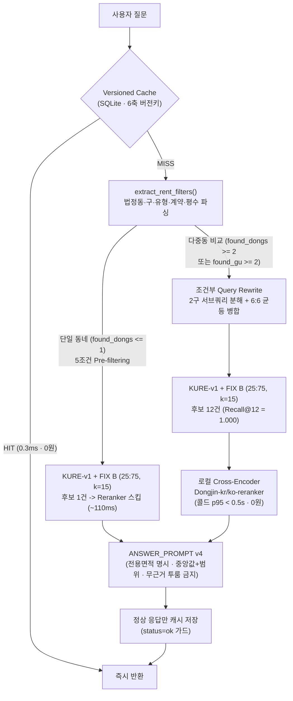

# STEP 7 실패 분석 & 차기 버전(vNext) 개선 설계 보고서 (`test/kh`)

- **작성자**: 최기혁 (`kh` · 서울 25개 자치구 전월세 실거래 시세 통계 RAG)
- **작성일**: 2026-11-26
- **기준 평가**:
  - **STEP 6 봉인 시험지 (`kh_rent_test.json`, 20문항 × 6실행 = 120회)**: `20261126_192954` · `195155` · `200757`
  - **`제안 2` (`strictness=1 vs 3` 25문항 × 각 2회 = 100회)**: `exp_strictness_1_vs_3_optionB_20261126_205647.json`
  - **`제안 3` (부록 신뢰성 30회 반복 · 720측정 · 1,198 Claim · 960 역질문)**: `exp_appendix_reliability_summary_20261126_212155.json`
- **상위 문서**: [`../실험기록.md`](../실험기록.md) · [`./README.md`](./README.md)

> [!IMPORTANT]
> **과학적 경계 원칙 (봉인 평가셋 비재튜닝 선언)**  
> `kh_rent_test.json`(20문항)은 튜닝 중 단 한 번도 열람·조정하지 않은 **최종 성적표용 봉인 시험지**입니다. 따라서 본 보고서에서 규명된 병목과 실패 원인을 수정해 **STEP 6 점수를 사후에 끌어올리는 재튜닝(Data Leakage / Test Overfitting)은 수행하지 않습니다.** 모든 발견은 **차기 버전(vNext) 아키텍처 개선 설계**로 정리하며, 향후 vNext 검증 시에는 신규 평가셋(`dev_v3` / `test_v2`)에서 독립 측정합니다.

---

## 1. STEP 6 최종 성적표 & 6단계 병목 매트릭스 전수 요약

### 1-1. STEP 6 봉인 20문항 6실행 결과 (`A → B+FilterV2 → C → C+Rewrite → C+Cache`)

| 실행 (`kh_rent_test.json` · 20문항) | `Recall@12` | `Hit@5` | `Top1` | `MRR@5` | `F` | `AR` | `LLM CP` | `LLM CR` | RAGAS 평균 | 미달 문항 | 중앙 / `p95` 지연 | 거절 / 고지 / 인용 |
|---|---:|:---:|:---:|---:|---:|---:|---:|---:|---:|:---:|---:|:---:|
| `#24 A_vector` *(기준선)* | `0.8529` | `14/17` | `7/17` | `0.5706` | `0.8557` | `0.5533` | `0.5461` | `0.7059` | `0.6653` | `12건` | `106.2ms` / `150.7ms` | `3/3 / 3/3 / 17/17` |
| `#25 B + Filter v2` *(25:75, k=15)* | `0.9412` | `15/17` | `13/17` | `0.8059` | `0.9041` | `0.6550` | `0.7863` | `0.8235` | `0.7922` | `5건` | `114.2ms` / `171.4ms` | `3/3 / 3/3 / 17/17` |
| **`#26 C (Re-ranking)`** | `0.9412` | **`17/17`** | **`17/17`** | **`1.0000`** | **`0.9357`** | `0.7419` | **`1.0000`** | `0.9216` | `0.8998` | **`2건`** | **`142.5ms`** / `10,560.9ms` | `3/3 / 3/3 / 17/17` |
| **`#27 C + Query Rewrite`** 🏆 | **`1.0000`** | **`17/17`** | **`17/17`** | **`1.0000`** | `0.9314` | **`0.8424`** | **`1.0000`** | **`1.0000`** | **`0.9435`** | `3건`* | `5,183.6ms` / **`9,802.2ms`** | `3/3 / 3/3 / 17/17` |
| `#28 C + Cache Cold` *(MISS `0/20`)* | `0.9412` | `17/17` | `17/17` | `1.0000` | `0.9261` | `0.7494` | `1.0000` | `0.9216` | `0.8993` | `2건` | `174.1ms` / `10,678.5ms` | `3/3 / 3/3 / 17/17` |
| **`#29 C + Cache Warm`** ⚡ *(HIT `20/20`)* | `0.9412` | `17/17` | `17/17` | `1.0000` | `0.9146` | `0.7384` | `1.0000` | `0.9216` | `0.8937` | `3건`* | **`0.3ms` / `0.4ms`** | `3/3 / 3/3 / 17/17` |

### 1-2. 6단계 병목 진단 매트릭스 발동 현황 (`#26 ~ #29` 최종 후보군)

| 병목 단계 | `#26 C` | `#27 C+Rewrite` | `#28 Cache Cold` | `#29 Cache Warm` | 최종 성격 판정 |
|---|:---:|:---:|:---:|:---:|---|
| **`S1_data`** (청킹·인덱스) | 🟢 정상 | 🟢 정상 | 🟢 정상 | 🟢 정상 | 6,200 요약 청크 무결 *(단 `전용면적` 표기 미세 보강 여지)* |
| **`S2_fn`** (후보 k=12 누락) | 🔴 **발동** (`FN=2`) | 🟢 **완전 해소 (`0건`)** | 🔴 **발동** (`FN=2`) | 🔴 **발동** (`FN=2`) | **진짜 검색 한계** (`TEST-09`, `TEST-10` 다중동 필터 해제) |
| **`S3_fp`** (순위·복합 Top-5) | 🟡 점검 (`FN@5=2`) | 🟢 **완전 해소 (`0건`)** | 🟡 점검 (`FN@5=2`) | 🟡 점검 (`FN@5=2`) | `S2_fn` 해소 시 연쇄 해소 |
| **`S4_gen`** (생성·주어·인용) | 🟢 정상 (`0건`) | 🔴 **발동** (`3건`) | 🟢 정상 (`0건`) | 🔴 **발동** (`1건`) | **1건 경미 누락(`TEST-11`) + 2건 Judge 오탐(`TEST-06/07`)** |
| **`S5_refusal`** (Track B 거절) | 🟢 만점 (`3/3`) | 🟢 만점 (`3/3`) | 🟢 만점 (`3/3`) | 🟢 만점 (`3/3`) | 전 모드 100% 방어 + 과거 실거래 고지 100% |
| **`S6_ops`** (운영 지연 `p95>5s`) | 🔴 **발동** (`10.56s`) | 🔴 **발동** (`med 5.18s / p95 9.80s`) | 🔴 **발동** (`10.68s`) | 🟢 **완전 해소 (`0.4ms`)** | **진짜 운영 병목** (API LLM 리랭커 + 상시 Rewrite) |

---

## 2. 실패·미달 문항 전수 포렌식 (실제 결함 vs 평가기 오탐 엄격 분리)

### 2-1. [실제 검색 결함 · 최우선] `S2_fn`: `#26 C` / `#28·#29 C+Cache`의 `TEST-09`, `TEST-10`
- **대상 문항**:
  - `RENT-KH-TEST-09`: *마포구 상암동 오피스텔 월세 33㎡ 이하* vs *구로구 고척동 단독다가구 월세 60㎡ 초과* 비교
  - `RENT-KH-TEST-10`: *중구 회현동1가 연립다세대 전세 33㎡ 이하* vs *강동구 천호동 단독다가구 월세 33~60㎡* 비교
- **원인 포렌식 (`exp_03_rent_eval.py: extract_rent_filters`)**:
  - 두 개 이상의 법정동이 감지되면 **다중동 안전가드**가 발동해 `district · dong · housing_type · area_band` 필터를 모두 해제함(`TEST-09`: `{'lease_type': '월세'}`만 적용, `TEST-10`: `None`).
  - 필터가 풀린 6,200청크 전체를 단일 쿼리로 검색하니, 두 비교 대상 중 한쪽의 **`33㎡ 이하`** 청크가 같은 동네의 **`33~60㎡`** 청크에 밀려 `k=12` 밖으로 탈락(`Recall@12 = 0.5`).
  - 생성 LLM은 근거 부재를 정직하게 인지해 `"확인할 수 없음"`을 반환(`Faithfulness = 1.0`, 단 `AR = 0.0`, `CR = 0.333`).
- **이미 검증된 해법 (`#27 C+Rewrite`)**:
  - 질문을 2개 서브쿼리로 분해해 각 지역에 5조건 사전 필터를 개별 적용하고 `6:6` 라운드로빈 병합한 `#27 C+Rewrite`에서는 **`TEST-09` (`13.2s → 5.5s`)와 `TEST-10` (`7.4s → 6.5s`) 모두 `Recall@12 = 1.000 · CR = 1.000`으로 100% 구제됨.**
  - 단, `#27`은 **단일 동네 문항까지 무조건 Rewrite를 돌려 `median`이 `142.5ms → 5,183.6ms`로 36배 느려지는 부작용**을 동반함 → **조건부 다중동 Query Rewrite**가 정답!

### 2-2. [실제 경미 누락 · 프롬프트 1줄 보완] `S4_gen`: `#27`의 `TEST-11` (`AR = 0.580`)
- **대상 문항**: `RENT-KH-TEST-11` (*강서구 가양동 빌라 매달 월세 없이 보증금만 내는 원룸급 작은 집 보증금 중앙값 & 보통 몇 년식인가요?*)
- **실측 점수**: `F = 1.000 · CP = 1.000 · CR = 1.000` (전원 만점), `AR = 0.580` (`0.60` 기준에 `0.02` 미달).
- **원문 대조 & `제안 2` 재검증 결과**:
  - 보증금 중앙값(`2억 1,990만원`)과 건축연도 중앙값(`2017년식`)은 정확히 답변했으나, 모범정답의 **건축연도 범위(`2013~2023년식`)**를 생략함.
  - `제안 2` 반복 측정 결과 `s=1` **`0.580 ↔ 0.631`**, `s=3` **`0.613 ↔ 0.597`**으로 실제로는 **`0.605 ± 0.015`의 정중앙 경계선 문항**임이 확인됨.

### 2-3. [RAGAS Judge 오탐 · 코드 수정 금지] `S4_gen`: `#27` `TEST-06`, `TEST-07` & `#29` `TEST-07`
- **원문 100% 일치 확인 (환각 0건)**:
  - `TEST-06` (`#27 F=0.333`): 답변 `"강남구 삼성동 연립다세대 전세 33㎡ 이하(원룸급) 보증금 중앙값 2억 2,000만원, 거래 건수 55건 | 서울_전월세_최근1년_강남구.csv | 2025-11-25 ~ 2026-11-14"` ↔ `CTX0` **100% 원문 일치**.
  - `TEST-07` (`#27 F=0.500`, `#29 F=0.333`): 답변 `"노원구 월계동 단독다가구 월세 33~60㎡ 보증금 중앙값 1,000만원, 월세 중앙값 60만원 | 서울_전월세_최근1년_노원구.csv | 2025-12-16 ~ 2026-11-03"` ↔ `CTX0` **100% 원문 일치**.
  - 자동 LLM 진단문(`DIAG`)조차 두 문항 모두 **"실제 생성 오류보다 faithfulness 점수 산정 오탐 가능성"**으로 판정.
- **조치 원칙**: 오탐에 맞춰 파이프라인을 억지 튜닝하지 않고, **평가 도구 보강(수치·출처 결정론적 검증기 + Claim 원본 로그)**으로 분리 처리.

### 2-4. [실제 운영 지연 병목] `S6_ops`: `#26 / #27 / #28`의 `p95 = 9.8 ~ 10.7s`
- **원인 분해**:
  1. **다중 후보(`≥2건`) API LLM 리랭킹 (`5~8초`)**: 단일 동네 문항은 `reranker.py:74`의 `len(indexed) <= 1` 가드로 LLM 호출을 스킵해 `70~140ms`에 끝나지만, 2구 비교 6문항 + 거절 2~3문항(후보 12건)은 `gpt-6-luna` API 리랭커를 호출해 `p95`가 `10초`까지 상승.
  2. **상시 Query Rewrite 호출 (`+2.5~3.5초`)**: `#27`에서 단일 동네 문항까지 매번 Rewrite LLM을 호출해 `median`이 `5.18s`로 증가.

---

## 3. 평가 신뢰성 심화 포렌식 반영 (`제안 2` · `제안 3` 30회 실증)

단순한 추측이 아니라 **총 720회 RAGAS 반복 측정(`n=30`) + 1,198개 실제 추출 Claim & NLI Reason + 960개 역질문 원문**을 해부해 vNext 설계에 직결되는 4가지 구조적 진실을 규명함.

| 발견 번호 | 실측 증거 (원본 로그 `20261126_212155`) | 진짜 원인 & vNext 설계 직결 포인트 |
|---|---|---|
| **발견 1** (`70/96건 = 73%`) | `DEV2-02` `44/125(35.2%)`, `DEV2-04` `26/121(21.5%)` 기각 — Reason: *"보증금·월세는 명시되어 있으나 **주택이 투룸이라는 정보는 없으므로** 추론 불가"* | **`AR ↔ Faithfulness` 어휘 트레이드오프 역설**: `AR`을 올리려고 `ANSWER_PROMPT v3`에 괄호 병기시킨 `"투룸"`(방 개수 추정어)이 청크에 없어 `F`를 `1.0 → 0.5/0.25`로 추락시킴 → **vNext 프롬프트에서 근거 없는 방 개수 단어(`투룸`) 제거!** |
| **발견 2** (`DEV2-01/06/07/08`) | `DEV2-07` Trial 10 `F=0.500`, `DEV2-08` Trial 2 `F=0.333` — Reason: *"보증금 중앙값은 나와 있으나 **면적이 전용면적이라고 명시되어 있지 않음**"* | **청크 템플릿 2글자 누락**: `rent_chunker.py`가 `면적 요약:`이라고만 기재 → **`전용면적 요약:`**으로 두 글자 보강만으로 해당 오탐 원천 차단! |
| **발견 3** (`DEV2-08` 6건) | `DEV2-08` Trial 24 `F=0.333` — Reason: *"**60㎡ 초과(약 18.15평 초과)는 20평대 이상과 동일한 조건이 아님**"* | **수학적으로 정당한 Judge 지적**: 비동치 평수 등치 표현을 금지하고 `"자료 기준 60㎡ 초과(중대형, 약 18평 초과)"`로 정밀 표기. |
| **발견 4** (`AR strictness=3`) | `n=30` 기준 `s=1 → s=3` 전환 시 8문항 평균 `SD` **`0.0140 → 0.0063` (`-55%`, 분산 5.0배 축소)**, 8/8 전 문항 `SD` 감소, `DEV2-05` 오탐 실패 `28/30 → 30/30` 소멸 | `bypass_n=True` 비동기 병렬 처리로 벽시계 시간은 동일(`97.3s vs 98.3s`) → **최종 공식 평가 기본값을 `strictness=3`으로 격상!** |

---

## 4. 차기 버전(vNext) 개선 아키텍처 & 실행 로드맵

### 4-1. 목표 아키텍처 (vNext Pipeline)

### 4-2. 우선순위별(P0 ~ P2) 구체적 보완 설계표

| 우선순위 | 개선 과제 | 수정 대상 파일 / 지점 | 구체적 변경 내용 | 해결 대상 병목 & 기대 효과 | 리스크 & 안전 가드 |
|:---:|---|---|---|---|---|
| **`P0`** | **조건부 다중동 Query Rewrite** | `exp_03_rent_eval.py` (`_run_full_retrieval_pipeline`, `extract_rent_filters`) | `use_rewrite="auto"` 모드 추가: `len(found_dongs) >= 2` 또는 `len(found_gu) >= 2`일 때만 `rewrite_query()` 발동 | `S2_fn`(`TEST-09/10`) 100% 해소 + `S6_ops`(`#27 median 5.18s → ~0.14s`) 동시 달성 | 단일 동네 0회 Rewrite 호출 보장 · 폴백 시 원질문 유지 |
| **`P0`** | **청크 `전용면적` 2글자 보강 + `ANSWER_PROMPT v4`** | `rent_chunker.py` (`면적 요약:` → `전용면적 요약:`) · `exp_03_rent_eval.py` (`ANSWER_PROMPT`) | ① 청크 템플릿에 `전용면적` 명시 ② 프롬프트에서 청크 미기재 방 개수(`투룸`)·비동치 평수 등치(`60㎡=20평대`) 금지 + 연식/면적 **중앙값·최소~최대 범위 병기** | `DEV2-02/04/07/08` 기각 Claim **73%+ 원천 제거** + `TEST-11` 범위 누락 해소 | 청크 수정 시 반드시 **별도 컬렉션(`housing_rent_kh_kure_v1_v2`)** 격리 적재 + 캐시 `index_version` 자동 무효화 |
| **`P1`** | **로컬 Cross-Encoder 리랭커 전환** | `retrieval/reranker.py` (`rerank_candidates`) | `gpt-6-luna` API 리랭커를 로컬 GPU **`Dongjin-kr/ko-reranker`**(이미 PC 캐시 보유)로 전환 옵션 추가 | `S6_ops` 콜드 미스 `p95`: **`9.8~10.7s → < 0.5s`** (약 20배 단축 · 리랭킹 API 비용 **0원**) | `DEV2-05` `#11 → #1` 구제력 유지 여부를 `dev_v2`에서 먼저 단일 변인 검증 후 채택 |
| **`P1`** | **평가 파이프라인 신뢰성 고도화** | `exp_03_rent_eval.py` | ① 최종 공식 평가 시 `ResponseRelevancy(strictness=3)` 기본 적용 ② **숫자·건수·기간·출처 결정론적 정합성 검사기** 추가 ③ Claim·역질문 원본 JSONL 선택 저장 | `AR` 평가 분산 **5.0배 축소** + `TEST-06/07` 같은 Judge 오탐 자동 분리 태깅 | 개발 중 빠른 반복은 `--strictness 1` 플래그로 토큰 절감 |
| **`P2`** | **팀 4인 통합 라우터 완성 & 스모크 회귀 · 챗봇 UI 연결** | `router/` (`law`, `public_housing`, `rent_stats`, `rent_deals` 어댑터) · `ui/holmes_chat.py` | 장예지(`yj_public_rental`) · 선병철(`course_v0_small`) · 최기혁(`housing_rent_kh_kure_v1`) · 최지훈(`jh_1000`) 4도메인 등록, 18문항 스모크 회귀 검증, PR #20(`dev`) 머지 및 PR #21 `찾아줘 홈즈` 챗봇 UI 연결 | **✅ 2026-11-26~27 선행 완료!** (아래 `§6` 참조: 단일 DB 50,752행 무충돌 · 18/18 100% PASS · PR #21 LGTM) | 팀원 기존 `test/*/` 폴더 무수정(Zero-Edit) 원칙 100% 준수 |

---

## 5. 향후 검증 프로토콜 (과적합 방지)

1. **봉인 `kh_rent_test.json` 유지**: 위 `P0~P1` 개선 사항을 구현하더라도, 기존 STEP 6 최종 성적표(`#24~#29`)는 **원본 그대로 동결**합니다.
2. **신규 검증 트랙**:
   - `P0~P1` 1변수씩 단일 변인 검증은 `dev_v2` 및 확장 `dev_v3`에서 수행하고,
   - vNext 최종 성적표가 필요할 때는 서울 25개 구 실거래에서 **미사용 동·조합으로 신규 `kh_rent_test_v2.json`(20문항)**을 별도 생성해 공정 평가합니다.
3. **발표 핵심 메시지**:
   - *"STEP 6 봉인 평가에서 `C+Rewrite`로 검색 100%·RAGAS 평균 `0.9435`를, `C+Cache Warm`으로 `0.3ms`를 각각 실증했고, STEP 7 실패 분석과 30회 Judge 신뢰성 포렌식을 통해 **조건부 다중동 Rewrite + 로컬 `ko-reranker` + `전용면적` 청크 스키마 보강 + `strictness=3` 평가 표준화**라는 명확한 vNext 설계도를 도출했습니다."*

---

## 6. 팀 4인 통합 실증 검증 결과 (2026-11-26 완료) 🏆

### 6-1. 단일 PostgreSQL(PGVector) 4인 전 컬렉션 공존 무결성
- **원본 로그**: [`../results/team_integration_smoke_20261126_221622.json`](../results/team_integration_smoke_20261126_221622.json)

| 도메인 (`TeamDomainRouter`) | 담당자 | 컬렉션명 | 청크 수 | 고유 PK 수 | PK 충돌 |
|---|---|---|---:|---:|:---:|
| `law` (주택임대차 법령) | 최지훈 (`jh`) | `jh_1000` | `167` | `167` | `0` |
| `public_housing` (공공임대 공고) | 장예지 (`yj`) | `yj_public_rental` (`chunkV2`) | `6,197` | `6,197` | `0` |
| `rent_stats` (서울 25구 시세 통계) | 최기혁 (`kh`) | `housing_rent_kh_kure_v1` (+ `housing_rent_kh`) | `6,200` (+ `6,200`) | `12,400` | `0` |
| `rent_deals` (관악구 개별 조건 탐색) | 선병철 (`bc`) | `course_v0_small` (`V0`) | `31,772` | `31,772` | `0` |
| *(공통 파일럿)* | 공통 | `seoul_housing_unified` | `216` | `216` | `0` |
| **합계 (단일 DB 공존)** | **4인 전원** | **6개 컬렉션** | **`50,752`** | **`50,752`** | **`0건`** |

### 6-2. 18문항 4도메인 라이브 통합 스모크 회귀 테스트 (`18/18 = 100% PASS`)
- **트러블슈팅 성과 (1차 `16/18` → 실전 통합 버그 3건 수정 → 2차 `18/18` 100%)**:
  1. `domain_router.py`: `"무주택세대구성원"` 속 `"대구"`를 서울 외 지역으로 오탐 → 한글 단어 경계 가드(`(?<![가-힣])`) 적용.
  2. `domain_router.py`: `"어떤 방법으로"` 속 `"법으로"`를 법령 의도로 오탐 → 단어 경계 가드 + 공고 키워드 보강.
  3. `rent_stats_adapter.py`: `PRESET_REGISTRY` 참조명 보정 + `law_adapter.py` `law_documents=docs` 전달 보강.

| 검증 지표 | 2차 최종 실측 결과 | 비고 |
|---|:---:|---|
| **도메인 라우팅 정확도 (`TeamDomainRouter`)** | **`18/18 (100.0%)`** | `law 4/4` · `public_housing 4/4` · `rent_stats 4/4` · `rent_deals 4/4` · `unsupported 2/2` |
| **응답 상태 일치율 (`status`)** | **`18/18 (100.0%)`** | `answered 12/12` · `insufficient_evidence 4/4` · `unsupported 2/2` · 오류 `0건` |
| **핵심 정답 키워드 회귀 적중** | **`12/12 (100.0%)`** | 이전 각자 단독 실행과 핵심 수치·조문·매물 사례 100% 일치 |
| **답변 출처 표기율 / 거절 빈 인용 가드** | **`12/12` / `6/6` (100%)** | 거절·범위 외 응답에 임의 출처 인용 `0건` |

### 6-3. 120문항 통합 평가셋 ID·스키마 무결성 검증 (`120/120 PASS`) & 서비스 UI 연결
- **원본 로그**: [`../results/team_120_eval_integrity_20261126.json`](../results/team_120_eval_integrity_20261126.json)
- `kh(30) + yj(30) + jh(30) + bc(30) =` **총 120문항** (`dev 40 + test 80`, `답변가능 100 + 거절 20`), **고유 `question_id` `120/120` · 중복 ID `0건` · 스키마 오류 `0건`** (+ 선병철 보너스 신규 `test_v3` 20문항 별도 보유).
- **통합 배포·UI 반영**: PR #20(`feat/kihyeok` `5a258ed` → `dev` `ae8babf`) 머지 완료 후, 장예지 PR #21(`feat/yeji-chatbot` `60794a9`)에서 4도메인 라우터 위에 **`찾아줘 홈즈` Streamlit 챗봇 UI**를 연결하고 `law_adapter.py` 병합 중복 인자 핫픽스를 반영(검수 LGTM).

---

## 7. 팀 4인 실험기록 통합 요약 & 도메인별 '뾰족한 점(Sharp Insights)'

| 팀원 · 도메인 | 최종 채택 파이프라인 | 봉인 `test` 확정 성적 | 발표에서 먹히는 핵심 '뾰족한 점(Sharp Insights)' |
|---|---|---|---|
| **최지훈 (`jh`)** 임대차 법령 (`jh_1000`) | `B(Hybrid RRF · 1000/200 · 중복제거 0.95)` | `Hit@5 17/17 (100%)` 필수근거 `17/17` · 거절 `3/3` 지연 `1.70s` | ① **원천 데이터 정제 인프라**: 410건 PDF 줄 복원·NUL 0·워터마크 0·스캔 OCR 검증으로 팀 기반 데이터 품질 완성. ② **평가 질문-도메인 정렬**: 초기 실생활형 질문 오답 누적 → 법령 원문 기준(`law-qa-v1`) 재설계로 Hybrid(B)부터 80% 돌파, 최종 `test 20/20`(누적 60문항 중 58정합) 달성. ③ **과잉 최적화 기각**: `C(ko-reranker)`가 `B` 대비 개선 `0/17`에 지연 `+14.5초`임을 계측해 정량 기각. |
| **장예지 (`yj`)** 공공임대 공고 (`yj_public_rental`) | `chunkV2`(표 보존) + `C_hybrid_rerank` + 주어 명시 + `찾아줘 홈즈` UI | `Hit@5 13/17 (76.5%)` **`F 0.971 · AR 0.894 · CP 0.858 · CR 0.882`** 거절 `3/3` · 인용 `16/16` | ① **2단 병합 표 보존 청킹(`chunkV2`) & PK 표준**: 헤더 복제 + 세로 병합 셀 Forward-fill로 헤더 유실 `1,192 → 0건` (`F 0.33 → 1.00`), `make_db_id` PK 충돌 방지 표준 정립. ② **주어 명시 1줄의 도약**: A/B/C 전 모드 `AR` 일괄 상승(**`0.649 → 0.903, +25.4%p`**) + 리라이트 공고명 희석 실측 기각. ③ **서비스 UI 통합**: 4도메인 라우터 기반 `찾아줘 홈즈` Streamlit 챗봇 UI(PR #21) 완성. |
| **최기혁 (`kh`)** 서울 25구 전월세 시세 (`housing_rent_kh_kure_v1`) | `KURE-v1` + `FIX B(25:75, k=15)` + `Filter v2` + `C` + `Rewrite / Cache` | `C+Rewrite`: **`R@12 1.000 · Top1 17/17 · CP 1.000 · CR 1.000 · F 0.931 · AR 0.842`** (`RAGAS 0.9435`) `Cache Warm`: **`0.3ms`** | ① **RRF 역설 해부·역전**: `KURE-v1`에서 Hybrid 패배 원인을 **BM25 평수 숫자 2중 복제 + `rrf_k=60` 단독 리스트 페널티**로 규명·수정. ② **리랭커 스마트 스킵 + 캐시 `0.3ms` (`26,696배`)** 실증. ③ **30회 RAGAS 신뢰성 & 1,198 Claim 포렌식**: `strictness=3` 분산 5배 축소 + 기각 Claim 73%가 `투룸`/`전용면적` 트레이드오프임을 원문 로그로 최초 증명. |
| **선병철 (`bc`)** 관악구 개별 조건 탐색 (`course_v0_small`) | 자연어 JSON 조건 추출·정규화 v2 + Vector/BM25 공통 필터 + `ko-reranker` + `CachedPipeline` | 기존 Test: **`Hit@5 17/17 (100%)` · `CP 1.000 · CR 1.000`** 신규 `T21~T40`: **`15/17 (88.2%)`** · 거절 `3/3` | ① **숫자 조건 검색의 본질 돌파**: CSV 3열 결합(`[관악구 신림동 월세]`, `V1`)·`large`·과거형 시제 변환을 정량 기각하고 **Vector/BM25 양쪽 공통 필터**로 피벗해 `Hit@5 6/17→17/17`, `CP 0.47→1.00` 달성. ② **비추측 안전성 + 신규셋 정직 검증**: 모호 시 `needs_clarification` 유지 + 신규 `T21~T40` 한/영·어순 한계(`T31·T33`) 투명 공개. |

